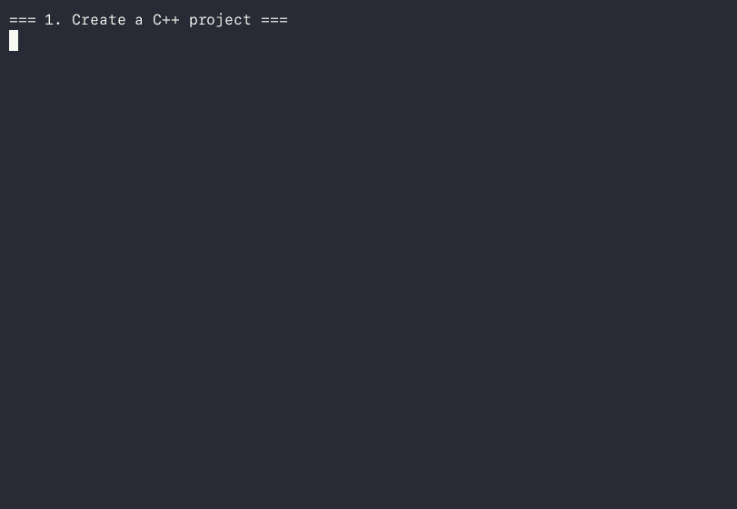

<p align="center">
<a href="https://crates.io/crates/sticks" rel="noopener noreferrer">

</a>
</p>
<h1 align="center">sticks</h1>

<p align="center">
  <em>A modern, lightweight CLI tool for managing C and C++ projects</em>
</p>

<p align="center">
  <a href="https://crates.io/crates/sticks"></a>
  <a href="https://github.com/mAmineChniti/sticks/actions"></a>
  <a href="https://codecov.io/gh/mAmineChniti/sticks"></a>
  <a href="LICENSE"></a>
</p>

<p align="center">
  <a href="#features">Features</a> •
  <a href="#installation">Installation</a> •
  <a href="#quick-start">Quick Start</a> •
  <a href="#usage">Usage</a> •
  <a href="#updating">Updating</a> •
  <a href="#contributing">Contributing</a>
</p>

---

## Features

- 🎯 **Interactive Mode** - Just run `sticks` for guided project setup with arrow key navigation
- 🚀 **Quick Project Setup** - Create new C/C++ projects with a single command
- 📁 **Multiple Build Systems** - Support for both Makefile and CMake with automatic conversion
- 🔨 **Smart Structure** - Auto-generates organized project structure with source files and build configs
- 📦 **Dependency Management** - Easily add/remove dependencies across Makefile, CMake, Conan and vcpkg
- 🔧 **Multi-Source Support** - Add multiple source files (build files auto-discover `src/` via glob/`find`, no manual edit needed)
- 📝 **Auto-Generated Config** - Creates .gitignore, .editorconfig, Clang-format config, VSCode settings (VSCode files only when `code` is installed)
- 🔄 **Verified Self-Update** - `sticks update` downloads the release binary only after checking it against the published `SHA256SUMS`
- 🔨 **Build & Run** - `sticks build`, `sticks run`, `sticks test` and `sticks clean` drive the project's real build system (Make or CMake, Ninja when available)
- 🔍 **`sticks doctor`** - Read-only environment check: compilers, make/cmake/ninja, git, curl, conan, vcpkg
- 🛡️ **Safe Edits** - `--dry-run` previews changes as a diff; modified files are backed up to `*.sticks.bak`; `sticks eject` leaves a plain project
- 📦 **Package Manager Integration** - Dependency manifests for Conan (`conanfile.txt`/`conanfile.py`) and vcpkg (`vcpkg.json`), with version constraints like `sticks add fmt@10.2.1`
- 🔧 **Modular Features** - Add/remove build systems and package managers to existing projects post-creation
- 🔀 **Git Integration** - Automatically initializes git repository when git is available
- ⚡ **Command Aliases** - Short aliases for faster typing (f, add-pm, rm-pm, etc.)
- 📦 **Self-Contained Binary** - Ships as a static binary; no Rust/Cargo needed at runtime (GCC to build your projects, `curl` for `sticks update`)
- ✅ **Quality Assured** - Comprehensive test suite (unit, filesystem integration and CI matrix on Ubuntu/macOS/Windows)
- 🔐 **CI/CD Pipeline** - Automated testing on every push; releases published only after the test suite passes
- ⚙️ **Advanced Build Config** - C++ standard, compiler flags, preprocessor definitions, include/library directories (multiline CMake supported)
- 🧪 **Test Framework Integration** - GoogleTest, Catch2, Doctest support with automatic setup
- 🔄 **CI/CD Generation** - Multi-distro GitHub Actions and GitLab CI templates (apt/dnf/pacman/apk/zypper/brew)
- 🎯 **Multi-Target Support** - Executables, static libraries, shared libraries in one project (platform-aware `.a/.so/.dylib/.lib/.dll`)
- 📚 **Documentation Generation** - Doxygen and Sphinx configuration generation
- 🔍 **Static Analysis Integration** - clang-tidy and cppcheck integration
- 🖥️ **Cross-Platform** - Linux, macOS and Windows binaries; system packages via apt/dnf/pacman/apk/zypper/brew/choco/scoop/nix

## Installation

Choose the installation method that works best for you:

### 📦 Package Managers (Recommended)

#### Arch Linux (AUR)

**Package Name:** `sticks-aur`

```bash
# Using an AUR helper (recommended)
yay -S sticks-aur
# or
paru -S sticks-aur

# Or manually clone from AUR
git clone https://aur.archlinux.org/sticks-aur.git
cd sticks-aur
makepkg -si
```

See [sticks-aur repository](https://aur.archlinux.org/packages/sticks-aur) for packaging details.

#### Debian/Ubuntu

```bash
# Download the latest .deb package
wget https://github.com/mAmineChniti/sticks/releases/latest/download/sticks_0.4.1-1_amd64.deb
sudo dpkg -i sticks_*.deb
```

### 🚀 Pre-built Binaries

```bash
# Linux (x86_64)
wget https://github.com/mAmineChniti/sticks/releases/latest/download/sticks-linux-x86_64
chmod +x sticks-linux-x86_64

# Verify against the published checksums before installing
wget https://github.com/mAmineChniti/sticks/releases/latest/download/SHA256SUMS
sha256sum -c SHA256SUMS --ignore-missing

sudo install -m 755 sticks-linux-x86_64 /usr/local/bin/sticks

# macOS (Apple Silicon example)
wget https://github.com/mAmineChniti/sticks/releases/latest/download/sticks-macos-aarch64
chmod +x sticks-macos-aarch64
sha256sum -c SHA256SUMS --ignore-missing   # after downloading SHA256SUMS above
sudo install -m 755 sticks-macos-aarch64 /usr/local/bin/sticks
# Windows: download sticks-windows-x86_64.exe from the releases page and
# verify its hash against SHA256SUMS (e.g. `certutil -hashfile sticks-windows-x86_64.exe SHA256`)
```

### 🦀 From Cargo

```bash
cargo install sticks
```

Requires Rust toolchain from [rustup.rs](https://rustup.rs/).

### 🔨 Build from Source

```bash
# Clone the repository
git clone https://github.com/mAmineChniti/sticks.git
cd sticks

# Build release binary
cargo build --release

# Install (choose one)
sudo cp target/release/sticks /usr/local/bin/  # System-wide
# or
cp target/release/sticks ~/.local/bin/         # User only
```

## Quick Start

### Interactive Mode (Easiest!)

Just run `sticks` with no arguments for an interactive guided experience:

```bash
sticks
```

Follow the prompts to:

1. Enter your project name
2. Choose language (C or C++)
3. Select build system (Makefile or CMake)
4. Your project is created!

Use arrow keys to navigate, Enter to select.

### Command Line

```bash
# Create a new C++ project with Makefile (default)
sticks cpp my-project
cd my-project

# Or with CMake build system
sticks cpp my-project --build cmake
cd my-project

# Add a dependency
sticks add libcurl

# Add more source files
sticks src utils network

# Build, run and test through sticks (works for Makefile and CMake)
sticks build
sticks run
sticks test
sticks clean
```

## Demo



The full new-user flow — scaffold, build/run/test, add a pinned dependency,
and eject back to a plain project — is recorded in `docs/demo.cast`
(re-recordable via `demo/demo.sh`, see `docs/demo.md`).

## Usage

### Interactive Mode

Run `sticks` without any arguments to enter interactive mode:

```bash
sticks
```

This launches a guided setup where you can:

- Enter project name
- Select language (C or C++) using arrow keys
- Choose build system (Makefile or CMake) using arrow keys
- Confirm with Enter to create your project

### Command Shortcuts

Common commands have short aliases for faster typing:

```bash
sticks i              # sticks init
sticks s myfile       # sticks src myfile
sticks a libcurl      # sticks add libcurl
sticks r libcurl      # sticks remove libcurl
sticks u              # sticks update
sticks f              # sticks feature
sticks cfg            # sticks config
sticks t              # sticks test
sticks tgt            # sticks target
sticks l              # sticks lint
```

#### Feature Subcommand Aliases

Feature management also supports shortcuts:

```bash
sticks f list                     # List project features
sticks f add-pm conan myapp             # Add Conan (shortcut for add-package-manager)
sticks f rm-pm vcpkg                    # Remove vcpkg (shortcut for remove-package-manager)
sticks f convert cmake                  # Convert build system
```

## Getting Started

**Create a new project in a subdirectory:**

```bash
sticks c my-c-project       # New C project with Makefile
sticks cpp my-cpp-project   # New C++ project with Makefile
```

**Create with CMake build system:**

```bash
sticks c my-project --build cmake       # C project with CMake
sticks cpp my-project --build cmake     # C++ project with CMake
```

**Create with package manager integration:**

```bash
sticks cpp my-project --build cmake --package-manager conan      # C++ with CMake and Conan
sticks c my-project --build cmake -p vcpkg                       # C with CMake and vcpkg
```

**Initialize in current directory:**

```bash
sticks init c               # Initialize C project here
sticks init cpp --build cmake  # Initialize C++ project with CMake
```

### Managing Dependencies

**Add dependencies:**

```bash
sticks add libcurl              # Single dependency
sticks add openssl libpq zlib   # Multiple dependencies
sticks add fmt@10.2.1           # With a version constraint
sticks add --system libcurl     # OS package via install-deps / find_package
```

Dependencies are written to the project's real package manager when one is
configured:

- `conanfile.txt` / `conanfile.py` `[requires]` for Conan (`name@1.2.3` becomes `name/1.2.3`)
- `vcpkg.json` `dependencies` for vcpkg (`name@1.2.3` becomes `"version>=1.2.3"`)

Otherwise:
- Makefile: `install-deps` target (system packages) + `LDLIBS` where a mapping is known — use `--system` to make this explicit
- CMake: `find_package()` + `target_link_libraries()`

**Remove dependencies:**

```bash
sticks remove libcurl           # Remove single dependency
sticks remove fmt@10.2.1        # Versioned spec also works
sticks remove --system libcurl  # Remove a system package
```

### Building, running and testing

`sticks` drives whatever build system the project uses — no need to
remember `make` vs `cmake --build`:

```bash
sticks build              # Debug build (Ninja generator for CMake when available)
sticks build --release    # Release build
sticks run                # Build, then run the program
sticks run -- --verbose   # Pass arguments to the program
sticks run --no-build     # Run the existing binary
sticks test               # ctest (CMake) or `make test` (Makefile)
sticks clean              # Remove build artifacts
```

CMake projects also get a standard `CMakePresets.json` (`debug`/`release`
configure, build and test presets), so `cmake --preset debug && cmake
--build --preset debug` and IDE integrations work without sticks.

### Safe edits

Every command that modifies files supports `--dry-run` (prints a unified
diff, writes nothing) and `--force` (overwrites after keeping a backup):

```bash
sticks add --dry-run curl    # Preview the diff
sticks feature convert --dry-run cmake
```

Modified files are automatically backed up to `<file>.sticks.bak` before
being overwritten, and repeated commands are idempotent. `sticks eject`
moves sticks-specific files (`.vscode/`, `CMakePresets.json`,
`.clang-format`, …) to `.sticks.bak` backups, leaving a plain project that
builds without sticks.

### Adding Source Files

```bash
sticks src utils               # Adds src/utils.cpp (or .c) and header
sticks src network database    # Add multiple source files
```

Sticks will:

- Create source files in `src/`
- Create corresponding headers in `include/`
- No build-file edit needed: generated Makefile (`find src`) and CMake (`GLOB_RECURSE src/*`) pick them up automatically

### Package Manager Integration

Sticks supports C/C++ package managers for dependency management:

#### Conan

> Note: Conan integration requires CMake (`--build cmake`). Makefile + Conan is rejected.

Create a project with Conan dependency management:

```bash
sticks cpp my-project --build cmake --package-manager conan
cd my-project
```

This generates a `conanfile.txt`. To add dependencies:

1. Edit `conanfile.txt` and add packages to the `[requires]` section:

   ```ini
   [requires]
   libcurl/7.85.0
   openssl/1.1.1q
   ```

2. Install dependencies: `conan install . --build=missing`

#### vcpkg

Create a project with vcpkg:

```bash
sticks cpp my-project --build cmake --package-manager vcpkg
# or using short flag
sticks cpp my-project --build cmake -p vcpkg
cd my-project
```

This generates a `vcpkg.json`. To add dependencies:

1. Edit `vcpkg.json` and add packages to the `"dependencies"` array:
  
   ```json
   "dependencies": [
     "libcurl",
     "openssl"
   ]
   ```

2. Install: `./vcpkg/vcpkg install`
3. CMakeLists.txt is pre-configured to use vcpkg toolchain

## Enhancing Existing Projects

After creating a project, you can add or modify features using the `sticks feature` (or `sticks f` for short) command:

### View Project Features

List all detected features and configurations:

```bash
sticks f list
```

Output shows:

- Current build system (Makefile or CMake)
- Configured package managers
- Configuration files status

### Convert Build System

Change between Makefile and CMake:

```bash
# Convert Makefile project to CMake
sticks f convert cmake

# Convert CMake project to Makefile
sticks f convert makefile

# Optionally specify project name (auto-detected if omitted)
sticks f convert cmake my_project
```

This will:

- Generate the new build configuration with your source files
- Preserve the old build file as `<old-file>.sticks.bak` (numbered if one already exists)
- Maintain project structure
- Re-apply package-manager integration when present
- Note: converting to Makefile while Conan is configured is rejected (Conan requires CMake)

### Add Package Manager

Add Conan or vcpkg to an existing project:

```bash
# Add Conan to current project
sticks f add-pm conan

# Add vcpkg
sticks f add-pm vcpkg

# Specify project name if needed
sticks f add-pm conan my_project
```

### Remove Package Manager

Remove a package manager if you no longer need it:

```bash
sticks f rm-pm conan
sticks f rm-pm vcpkg
```

### Example Workflow

Start with a bare Makefile project, then enhance it:

```bash
# Create basic C project with Makefile
sticks c my_app
cd my_app

# Later, add CMake support
sticks f convert cmake

# Then add Conan for dependencies
sticks f add-pm conan

# View all features
sticks f list
```

## Advanced Build Configuration

Sticks provides advanced C++ build configuration options:

### Build Configuration

Configure C++ standard, compiler flags, preprocessor definitions, and directories:

```bash
# Set C++ standard (applied immediately)
sticks config set-cpp-standard 17

# Add compiler flags (applied immediately)
sticks config add-flag -Wall -O2

# Add preprocessor definitions (applied immediately)
sticks config add-def DEBUG VERSION=1.0

# Add include directories (applied immediately)
sticks config add-include include src

# Add library directories (applied immediately)
sticks config add-lib-dir lib /usr/local/lib

# Remove items (applied immediately)
sticks config remove-flag -Wall
sticks config remove-def DEBUG
```

Note: All configuration changes are applied immediately to your build file (CMakeLists.txt or Makefile). No separate "apply" step is needed.

### Test Framework Integration

Add testing frameworks to your project:

```bash
# Add GoogleTest
sticks test add gtest

# Add Catch2
sticks test add catch2

# Add Doctest
sticks test add doctest

# Generate a test file and wire it into the build (optional framework parameter)
sticks test generate my_project
sticks test generate my_project --framework catch2
```

This automatically:
- Adds `find_package()` directive to CMakeLists.txt
- Enables testing with `enable_testing()`
- Creates test executable target
- Adds test dependencies
- For Makefile: adds test target with proper linking

### CI/CD Generation

Generate CI/CD pipeline configurations:

```bash
# Generate GitHub Actions workflow
sticks ci generate github

# Generate GitLab CI configuration
sticks ci generate gitlab

# Write CI/CD configuration to file
sticks ci write github
sticks ci write gitlab
```

Generated pipelines include:
- Build stage (cmake configuration and build)
- Test stage (ctest execution)
- Lint stage (clang-tidy for static analysis)

### Multi-Target Projects

Manage multiple build targets (executables, static libraries, shared libraries):

```bash
# Add executable target (applied immediately)
sticks target add myapp --type exe -s src/main.cpp -d pthread

# Add static library target (applied immediately)
sticks target add mylib --type static -s src/lib.cpp

# Add shared library target (applied immediately)
sticks target add mylib --type shared -s src/lib.cpp -d pthread

# List all targets
sticks target list

# Remove a target
sticks target remove mylib
```

Note: Targets are added/removed immediately in your build file (CMakeLists.txt or Makefile).

### Documentation Generation

Add documentation tools to your project:

```bash
# Add Doxygen
sticks docs add doxygen

# Add Sphinx
sticks docs add sphinx

# Generate documentation configuration (optional tool parameter)
sticks docs generate my_project
sticks docs generate my_project --tool sphinx

# Write documentation configuration to file (optional tool parameter)
sticks docs write my_project
sticks docs write my_project --tool sphinx
```

### Static Analysis Integration

Add static analysis tools for code quality:

```bash
# Add clang-tidy
sticks lint add clang-tidy

# Add cppcheck
sticks lint add cppcheck

# Generate static analysis configuration (optional tool parameter)
sticks lint generate
sticks lint generate --tool cppcheck

# Write static analysis configuration to file (optional tool parameter)
sticks lint write
sticks lint write --tool cppcheck
```

This adds:
- clang-tidy configuration (`.clang-tidy`)
- cppcheck configuration (`cppcheck.xml`)
- CMake integration with `find_program()`
- Makefile integration with lint targets

### Generated Configuration Files

When you create a project, Sticks automatically generates:

- **Build System Files:** `Makefile` or `CMakeLists.txt` (your choice)
- **Git:** `.gitignore`, `.gitattributes` (pre-configured for C/C++), auto-initializes git repository (if git is installed)
- **Code Style:** `.editorconfig`, `.clang-format` (consistent formatting)
- **IDE:** VSCode `.vscode/settings.json`, `launch.json`, `tasks.json` (if VS Code is installed)
- **Documentation:** `README.md` (project-specific template)

This gives you a professional, production-ready project structure out of the box!

### Getting Help

```bash
sticks --help           # Show all commands
sticks <command> --help # Help for specific command
sticks --version        # Show version
```

## Updating

Sticks checks for updates without requiring Rust/Cargo:

```bash
sticks update
```

For binaries installed outside a package manager, `sticks update` downloads
the release artifact for your OS/architecture, verifies it against the
`SHA256SUMS` file published with every release, and only then replaces the
installed binary (the previous one is kept as `sticks.sticks.bak`). If the
checksum does not match, the update aborts and nothing is replaced.

Installs managed by a package manager are updated through that manager
instead:

```bash
# Arch Linux (AUR package name: sticks-aur)
yay -Syu sticks-aur    # or: paru -Syu sticks-aur

# Homebrew
brew upgrade sticks

# Cargo installation
cargo install sticks --force
```

## Uninstallation

```bash
# Cargo installation
cargo uninstall sticks

# Arch Linux (AUR package name: sticks-aur)
yay -R sticks-aur
# or
paru -R sticks-aur

# Debian/Ubuntu
sudo apt remove sticks

# Manual installation
sudo rm /usr/local/bin/sticks
# or
rm ~/.local/bin/sticks
```

## Project Structure

A typical sticks-managed project looks like:

```bash
my-project/
├── src/
│   ├── main.cpp        # Entry point
│   ├── utils.cpp       # Additional sources
│   └── network.cpp
├── include/
│   ├── utils.h         # Headers
│   └── network.h
├── bin/                # Final compiled binaries (gitignored)
├── build/              # Object files and build artifacts (gitignored)
├── Makefile            # Or CMakeLists.txt, depending on --build
└── README.md           # Auto-generated
```

## Technical Details

- **Language:** Rust 2024 edition
- **Dependencies:** anyhow, clap 4 (+ clap_complete, clap_mangen), dirs, libc, regex, serde_json, sha2, similar, strsim
- **Dev Dependencies:** serial_test, tempfile (for isolated test execution)
- **Runtime Requirements:** a C/C++ toolchain for building your projects (gcc, clang, or MSVC — detected automatically, overridable with `--cc`/`--cxx`); `curl` required for `sticks update`
- **Supported Architectures:** x86_64, aarch64, armv7 (Linux); x86_64, aarch64 (macOS and Windows)
- **Supported Platforms:** Linux, macOS and Windows binaries are built; system packages via apt/dnf/pacman/apk/zypper/brew/choco/scoop/nix
- **Test Coverage:** measured by `cargo tarpaulin` in CI (see the codecov badge for the current number); the suite includes regression tests for build-file corruption and update-verification scenarios
- **Library Use:** `detect_build_file_in`, `detect_build_system_in`, `detect_package_manager_in`, `Language::from_project_structure_in`, `project_path_in`, `generate_vscode_tasks_config_in/for` avoid global CWD state
- **CMake Parsing:** multiline `find_package`/`target_link_libraries`/`add_executable`/`add_library` with quote- and comment-awareness
- **Conan:** multiline `requires` blocks, tuples, and `self.requires(..., ...)` with extra args are parsed
- **Makefile:** `.RECIPEPREFIX` respected; atomic writes fsync file + parent dir
- **CI/CD:** Automated testing, building, and releases via GitHub Actions

## Shell completions and man page

```bash
sticks completions bash > ~/.local/share/bash-completion/completions/sticks
sticks completions zsh > ~/.zfunc/_sticks
sticks man | man -l -
```

## How sticks compares

sticks is deliberately a **thin layer**: it scaffolds projects and edits
standard `Makefile`/`CMakeLists.txt`/`conanfile.*`/`vcpkg.json` files. The
generated project builds with plain `make` or `cmake` — sticks is never
required again (`sticks eject` removes its metadata entirely).

- **CMake presets / `cmake --preset`**: presets are a CMake feature, not a
  project manager. sticks *generates* a `CMakePresets.json` for you and can
  drive it (`sticks build/run/test`), but does not replace CMake.
- **xmake**: a full alternative build system with its own DSL and package
  repository. Choose xmake if you want one tool to own the whole build;
  choose sticks if you want standard Make/CMake output you can take
  anywhere.
- **Meson**: another full build system (simpler than CMake, smaller
  ecosystem). sticks does not compete with it — it emits CMake/Make.
- **CForge**: a C/C++ project scaffolding CLI focused on generating
  project structure and build files. sticks overlaps here, and additionally
  manages dependencies across Conan/vcpkg and drives build/run/test.
- **Craft**: JetBrains' C++ package/build manager with its own package
  format and huge prebuilt binary repository. Craft is much heavier and
  prescribes its own workflow; sticks stays lightweight and
  package-manager-agnostic.

If your priority is "standard files I can leave behind", sticks fits. If you
want a batteries-included ecosystem, xmake/Craft/Meson are stronger fits.

## Contributing

We welcome contributions! Here's how to get involved:

1. **Report Issues:** Found a bug? [Open an issue](https://github.com/mAmineChniti/sticks/issues)
2. **Submit PRs:** Fork the repo and submit pull requests
3. **Improve Docs:** Help us make documentation better

See [CONTRIBUTING.md](CONTRIBUTING.md) for detailed guidelines.

## Contributors

This project is maintained by:

<table>
  <tr>
    <td align="center">
      <a href="https://github.com/mAmineChniti">
        
        <br />
        <sub><b>mAmineChniti</b></sub>
      </a>
      <br />
      <sub>Creator & Maintainer</sub>
    </td>
    <td align="center">
      <a href="https://github.com/omibo">
        
        <br />
        <sub><b>omibo</b></sub>
      </a>
      <br />
      <sub>Contributor</sub>
    </td>
  </tr>
</table>

## License

This project is licensed under the MIT License. See the [LICENSE](LICENSE) file for details.

## Contact

**Maintainer:** mAmineChniti  
**Email:** [emin.chniti@esprit.tn](mailto:emin.chniti@esprit.tn)  
**Repository:** [github.com/mAmineChniti/sticks](https://github.com/mAmineChniti/sticks)  
**AUR Package:** [aur.archlinux.org/packages/sticks-aur](https://aur.archlinux.org/packages/sticks-aur)

---

<p align="center">Made with ❤️ for the C/C++ community</p>
